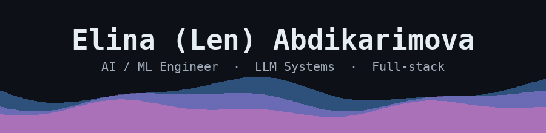
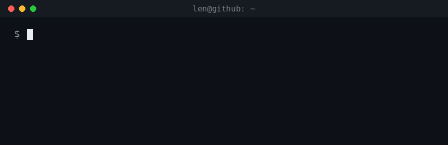
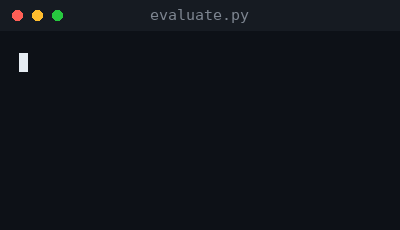
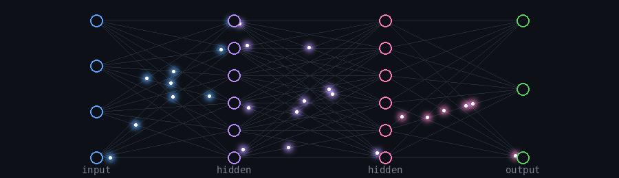

 

## 👋 About me

<table>
<tr>
<td valign="top">

- 🤖 **AI/ML engineer.** I build ML and LLM systems and test them properly: baselines, held-out data, error analysis
- 🔨 **Building now:** an LLM transaction categoriser (baseline vs LLM vs hybrid) and a walk-forward return-prediction pipeline on CSI 300
- 🎓 **M.S. in Computer Science**, Beijing Institute of Technology · first-author paper at **IEEE CIBCB 2026**
- 🛠️ **Production-minded:** Flask/Django backends, Docker, tests, and an LLM-powered HR screening tool (Claude + Kimi APIs) from my AI internship
- 🌍 **Based in Beijing** · Russian & Kyrgyz (native), English (fluent), 中文 & Türkçe (conversational)
- 🏐 **Off-screen:** volleyball and playing with creative AI tools

</td>
<td valign="top" width="400">

</td>
</tr>
</table>

## 🔎 What I'm looking for

AI/ML engineer and applied-AI roles, or full-stack roles with a real ML component. I'm strongest where a model has to be **built, evaluated honestly, and shipped**. Open to relocation and remote.

## 🚀 Featured projects

| Project | What it is | Stack |
|---|---|---|
| **[LLM Transaction Categoriser](https://github.com/kshljkel16/llm-transaction-categoriser)** | Sorts messy bank-transaction strings into spending categories. Compares a TF-IDF + logistic regression baseline, an LLM-only classifier and a hybrid router on held-out merchants, with SQL error analysis | Python · scikit-learn · LLM APIs · SQLite · pytest · Docker |
| **CSI 300 return prediction** *(in progress)* | LightGBM vs a momentum baseline, walk-forward validation, RankIC and a cost-adjusted portfolio | Python · pandas · LightGBM |
| **[RNA reactivity research code](https://github.com/kshljkel16/rna-reactivity-prediction)** | Code behind my IEEE CIBCB 2026 paper: BiLSTM vs CNN+Attention vs Transformer | Python · PyTorch |

## 🛠️ Tech stack

**Languages**

**AI / Machine Learning**

**Backend & tools**

## 🎛️ Outside of code

I play volleyball, I like trying new creative AI tools (especially video generation), and I'm always happy to talk ML, evaluation, or language learning. Say hi in any of five languages.

 

## 📫 Let's connect

